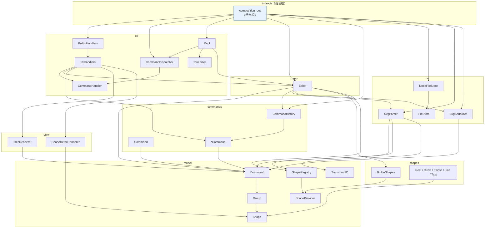
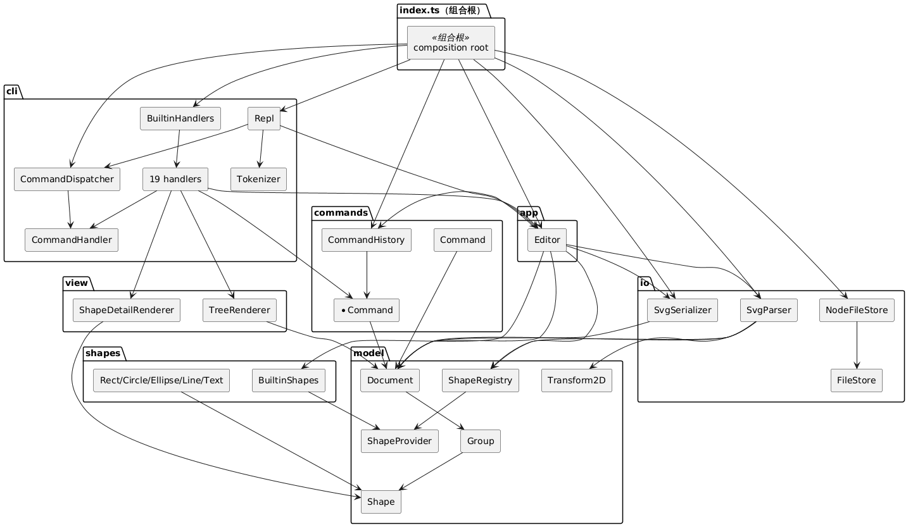
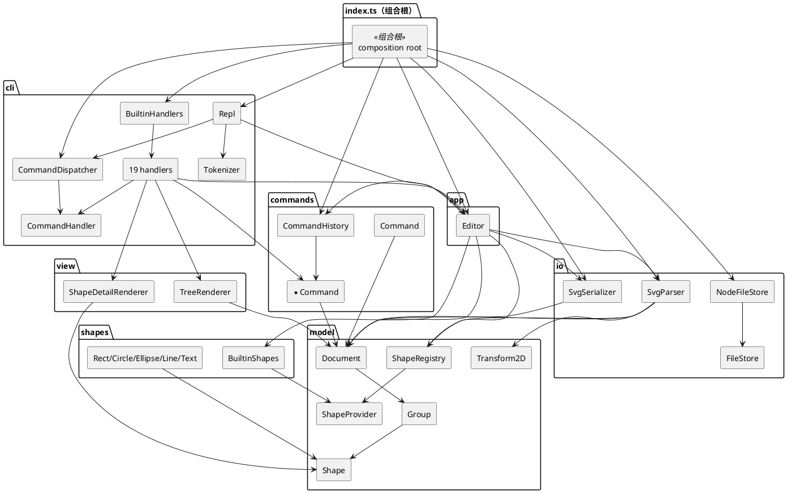
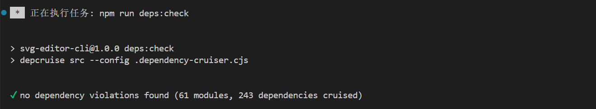

# SVG 编辑器（CLI）架构说明

本文档记录了本 lab 的架构方案、开发过程、一致性自查与质量保证手段。

## 0. 运行与验证

### 0.1 环境

```text
Node.js 24.22.1
npm 11.19.1
npx 11.19.1
```

### 0.2 常用命令

```bash
npm install      # 安装依赖
npm run cli      # 启动 REPL，提示符为 svg>
npm run build    # TypeScript 类型检查
npm test         # vitest 测试 + dependency-cruiser 依赖方向检查
```

## 1. 架构方案

### 1.1 模块划分与职责

项目代码分为 7 个 `src` 模块，外加一个组合根 `index.ts`：

```text
src/
├── index.ts       组合根：只装配具体实现，不承载业务规则
├── model/         领域核心：图形/文档抽象、Composite、id 索引、类型插槽
├── shapes/        内置图形：Rect、Circle、Ellipse、Line、Text 与注册入口
├── commands/      可撤销编辑操作对象与历史栈
├── io/            SVG 文本解析、序列化、文件读写边界
├── view/          tree / show 的文本布局
├── app/           业务门面 Editor：文档、历史、IO 与 provider 编排
└── cli/           分词、命令分派、参数校验、REPL
```

| 模块 | 职责 | 关键类 |
|------|------|--------|
| `model` | 定义图形/文档模型、id 索引、Composite 语义和图形类型插槽；不感知文件、命令、控制台 | `Shape`、`Group`、`Document`、`ShapeProvider`、`ShapeRegistry`、`DomainError`、`NumberFormat`、`Transform2D`、`ShapeSnapshot`、`SvgNodeData` |
| `shapes` | 内置叶子图形：几何值、属性白名单、缩放规则、显示字段、SVG 属性数据 | `Rect`、`Circle`、`Ellipse`、`Line`、`Text`、`BuiltinShapes` |
| `commands` | 每个编辑动作封装为可撤销对象，只操作 `Document`；管理 undo/redo 历史 | `Command`、`CommandHistory`、`CreateCommand`、`DeleteCommand`、`MoveCommand`、`ScaleCommand`、`SetCommand`、`GroupCommand`、`UngroupCommand`、`AddToCommand`、`ZOrderCommand` |
| `io` | 文件/SVG 文本与 `Document` 互转；解析容错、transform 扁平化、序列化格式 | `SvgParser`、`SvgSerializer`、`FileStore`、`NodeFileStore` |
| `view` | `tree` / `show` 的缩进、连接符、字段对齐；只消费图形暴露的字段 | `TreeRenderer`、`ShapeDetailRenderer` |
| `app` | 对 CLI 提供统一业务入口：当前文档、历史、文档类命令、provider 查询 | `Editor` |
| `cli` | 输入翻译层：分词、命令名到 handler 的分派、参数校验、REPL 生命周期 | `Tokenizer`、`CommandHandler`、`CommandDispatcher`、`BuiltinHandlers`、`Repl`、19 个 handler |

### 1.2 组件图

图中箭头表示编译期依赖方向。`Shape` 与 `Group` 之间的 type-only 引用由依赖规则豁免，不计入运行时依赖。



<details>
<summary>PlantUML 代码详情</summary>



</details>

### 1.3 设计模式：统一采用 Command 模式

本项目采用 **Command 模式**。图形组合语义由 `Shape` / `Group` 承担，图形类型注册由 `ShapeProvider` / `ShapeRegistry` 承担，文件边界由 `FileStore` 承担。

**Command 如何落地**

- `Command` 接口只暴露 `execute(document)` 和 `undo(document)`，每个编辑命令都是实现该接口的独立类。
- `Editor` 不按命令名写分支，只把 `Command` 交给 `CommandHistory` 执行；CLI handler 负责把用户输入翻译成具体的 `Command` 对象。
- `CommandHistory` 维护 undo/redo 双栈，处理文档类命令后的历史锁定，以及新编辑清空 redo 栈。
- 一条编辑命令是一个 undo 单元；`redo` 直接重新执行同一个 `Command`，因此成功回显和首次执行一致。

| 命令 | 对应 Command | 撤销状态 |
|------|--------------|----------|
| `create` | `CreateCommand` | 记录被创建子树的 id |
| `delete` | `DeleteCommand` | 保存整棵子树、原父容器、原索引 |
| `move` | `MoveCommand` | 保存位移增量，undo 取反 |
| `scale` | `ScaleCommand` | 执行前保存子树快照，undo 原位恢复 |
| `set` | `SetCommand` | 保存旧值或缺省状态 |
| `group` | `GroupCommand` | 保存每个成员的原父/原索引、新组 id |
| `ungroup` | `UngroupCommand` | 保存原组、原父/索引、子顺序 |
| `addto` | `AddToCommand` | 保存原父/索引 |
| `front` / `back` | `ZOrderCommand` | 保存原索引 |

`scale` 与 `set` 不用 `1/factor` 反算，而用 `snapshot()/restore()`，是为了避免浮点误差累积，并正确还原“属性从未设置”的缺省状态。

**支撑 Command 的结构**

- `Shape` / `Group`：容器与叶子统一提供 `move`、`scale`、`setAttr`、`snapshot`、`restore` 等接口，使命令不写 `switch(tag)`，可对普通图形和容器一视同仁。
- `ShapeProvider` / `ShapeRegistry`：图形创建的唯一按名分派入口。`CreateCommand` 只通过 provider 构造图形，CLI 参数校验也读取 provider 的 `params`，为后续 `box` 等插件类型留出扩展点。
- `FileStore` / 注入的 parser、serializer：把文件访问和序列化边界从 `Editor` 中拆出，测试可以用内存实现替换。

### 1.4 依赖方向规则

“可以依赖”表示模块允许 import 被依赖模块。违反规则即为待处理项。

| 模块 | 可以依赖 | 理由 |
|------|----------|------|
| `model` | 无，仅 TypeScript 标准类型 | 领域核心必须独立演进，不能被 io、UI、命令层反向绑定 |
| `shapes` | `model` | 具体图形只实现 `Shape` / `ShapeProvider` 抽象 |
| `commands` | `model` | 编辑操作只改变文档树，不接触文件和显示 |
| `io` | `model` | 解析/序列化只消费领域模型；不直接认识 `shapes` 中的具体类 |
| `view` | `model` | 渲染器只读取图形暴露的字段，不依赖具体图形实现 |
| `app` | `model`、`commands`、`io`、`shapes` | `Editor` 是唯一装配这些模块的业务门面 |
| `cli` | `app`、`commands`、`view`、`model` | 输入翻译层；不依赖 `io` 和具体图形实现 |
| `index.ts` | 全部 | 组合根，唯一允许实例化具体实现的位置 |

落地方式：`.dependency-cruiser.cjs` 使用 `forbidden` 规则表达同一张表，`npm test` 的最后一步执行 `depcruise src`，依赖违规会直接失败。`index.ts` 作为组合根豁免。

### 1.5 变化点假设

| # | 未来可能发生的变化 | 当前预留 | 说明 |
|---|--------------------|----------|------|
| 1 | 新增图形类型，如 `box` | `ShapeProvider` 插槽 + `ShapeRegistry` | 新增 provider 并注册即可；解析端可凭 `data-kind` 还原，内核不必识别具体类 |
| 2 | 新增或修改命令语法 | handler + `Command` 类 | 命令分派集中，业务规则不散落在 REPL |
| 3 | 调整 tree / show / SVG 输出格式 | 独立 renderer 与 serializer | 图形只提供字段和属性数据，不直接生成字符串 |
| 4 | 更换存储介质 | `FileStore` 接口 | 替换实现即可，`Editor` 不需要变化 |
| 5 | 需要支持 `rotate` / `matrix` | `Transform2D` | 本期明确不支持；解析时警告并按单位阵处理，后续可替换为完整仿射矩阵 |
| 6 | 撤销策略改为 diff | Command 封装 | 调用方只看到 `execute` / `undo`，历史栈不感知快照细节 |
| 7 | 外部 SVG 出现更多未知标签或方言 | 解析警告集中在一处 | 当前策略为跳过并警告，不静默吞数据 |
| 8 | 多用户 / 并发编辑 | 决定不留 | 本阶段是单进程单文档 CLI，引入锁和版本号没有真实收益 |
| 9 | 中文错误文案或 i18n | 决定不留 | 需求规定英文固定文案，集中常量即可后续替换；当前抽 i18n 层属于过度设计 |

## 2. 过程记录

过程记录按开发顺序整理如下。同时，[development_log.md](development_log.md) 中记录了更详细的开发过程。

**Step 0：需求与设计**

- 先依据 `phase_cli_1.md` 写出 `design.md`，把“禁止贫血模型、只允许两处按名分派、容器与叶子统一操作”等约束翻译成模块边界。
- 确定核心决策：编辑命令统一走 Command + 快照式 undo；`box` 本阶段不实现，只通过 `ShapeProvider` 预留。

**Step 1：工程骨架与 model**

- 初稿把 `NumberFormat` 解析失败抛成普通 `Error`，REPL 会误判为 `internal error`。对照需求的 `error:` 约定后改为 `DomainError`。
- `tsconfig` 开启 `strict`、`noUncheckedIndexedAccess`、`exactOptionalPropertyTypes`，在 `Document` 索引访问和可选参数处补显式判空。
- `Document.reparent` 增加同父同索引的提前返回，避免短暂丢索引。

**Step 2：图形与变换**

- 先实现 `Rect` 作为模板，再按同一模式完成 `Circle`、`Ellipse`、`Line`、`Text`，最后注册到 `BuiltinShapes`。
- 把 `move/scale` 的几何变换收敛到 `Transform2D` + `Shape.applyTransform`，避免每个叶子重复实现，也为 Step 3 的 SVG transform 扁平化复用。
- 增加 `.gitattributes` 固定 LF，避免 Windows CRLF 影响 round-trip 字节比较。

**Step 3：io**

- 引入 `fast-xml-parser` 解析 XML，序列化仍由手写生成器完成。
- 解析器最初想按标签名直接 `new Rect(...)`，会让 `io` 依赖 `shapes` 并复制参数表；改为只经过 `ShapeRegistry` + `provider.create`。
- 嵌套 `translate/scale` 用组合矩阵扁平化，测试断言内层矩形最终几何值，与需求示例一致。
- `rotate/matrix` 不在本期范围，选择“警告 + 按单位阵处理”，保证用户能看到降级行为。

**Step 4：命令**

- `ScaleCommand` 不用 `1/factor` 反算，改用执行前快照、undo 时原位恢复，并用 3 倍缩放验证能精确回到原值。
- `group` 的插入锚点定义为：新组插入第一个成员的原父容器、所有成员摘除后第一个成员的索引；同时检查祖先成环。
- `tsc` 直接暴露 `GroupCommand` 中集合变量名写错的问题，验证了 strict 类型检查的价值。

**Step 5：视图与门面**

- `show` 根级图形的父级显示修正为 `svg`，而不是不存在的 `g#svg`。
- 需求中 tree 示例的列间距存在矛盾，因此不逐字复刻某一份，而是采用确定性规则：同一份输出按最宽标签对齐。
- `save` 无路径且从未 read/save 时补充固定错误文案。

**Step 6：CLI**

- `Tokenizer` 增加 `quoted` 标记，只把未加引号的 `in` 当作 `create` 子句，解决 `create text t1 20 40 "in"` 的歧义。
- 参数个数错误统一为 `usage: <语法>`；`init/canvas` 只接受 0 或 2 个参数，避免半更新。
- REPL 的输入边界做成 `AsyncIterable`，测试注入数组即可回放会话。

**Step 7：集成与依赖检查**

- 增加 `test/support/session.ts`，让 REPL 和 Editor 测试复用内存 `FileStore` 与假终端。
- 需求第 6 节的完整会话已纳入集成测试，输出逐字比对 34 行。
- 用 `dependency-cruiser` 固化依赖矩阵；发现并豁免 `Shape ↔ Group` 的 type-only 回路，其余模块零违规。

## 3. 一致性自查

### 3.1 模块划分

实际目录与架构方案一致：`src` 下为 `model / shapes / commands / io / view / app / cli` 七个模块，外加 `index.ts` 组合根。

实现差异：

1. `src/cli/BuiltinHandlers.ts`：集中注册 19 个 handler，供组合根与测试复用。
2. `src/cli/handlers/`：实际有 19 个 handler，设计文档最初按 15 个描述，已按实际命令清单修正。
3. `test/support/session.ts`：内存 `FileStore`、假终端和会话回放，属于测试支撑文件。
4. `.dependency-cruiser.cjs`：位于仓库根目录，是依赖检查工具默认位置，不属于 `src` 模块。

### 3.2 依赖方向

`npm run deps:check` 结果：



抽样核对：

- `src/model/*` 只互相导入，无第三方运行时依赖；
- `src/io/SvgParser.ts` 只导入 `model` 中的 `ShapeRegistry`、`Document`、`Transform2D` 等，不导入 `shapes`；
- `src/view/*` 只导入 `model`；
- `src/app/Editor.ts` 导入 `model/commands/io/shapes`，不导入 `view/cli`；
- `src/cli/handlers/*` 导入 `app/commands/view/model`，不导入 `io/shapes`；
- 唯一豁免：`src/index.ts` 组合根，以及 `Shape ↔ Group` 的 type-only 回路。

## 4. 质量保证手段

**功能完整性**

- `test/integration/Transcript.test.ts` 覆盖[phase_cli_1.md 第 6 节](phase_cli_1.md)的完整会话，逐字比对 34 行输出。
- 每个编辑命令都有 `execute → undo → redo` 往返用例，校验回显文案、树结构和属性值一致。
- 解析器覆盖：缺 id 自动补全、重复 id 重命名、未知标签跳过、嵌套 transform 扁平化、画布尺寸三种来源、带单位数字解析。
- 覆盖 `parse → serialize → parse` round-trip，序列化产物稳定。

**质量手段**

| 手段 | 说明 |
|------|------|
| TypeScript strict | `strict` + `noUncheckedIndexedAccess` + `exactOptionalPropertyTypes`，`npm run build` 零告警 |
| 单元与集成测试 | 14 个测试文件、137 个 vitest 用例，覆盖 model/shapes/commands/io/view/app/cli 与整链 transcript |
| 依赖方向检查 | `dependency-cruiser` 规则与 1.4 依赖矩阵对应，纳入 `npm test` |
| 边界注入 | `FileStore`、`ReplIo` 通过接口注入；测试不碰真实磁盘和终端 |
| 真机冒烟 | 使用管道回放 `init/create/tree/show/move/undo/save/read`，确认组合根装配正确 |
| 错误路径 | 每个固定错误文案都有用例：id 冲突/不存在、非容器、成环、顶层 ungroup、非正 factor、非法数字、缺参数、未知命令、未知类型、文件不可读写 |

