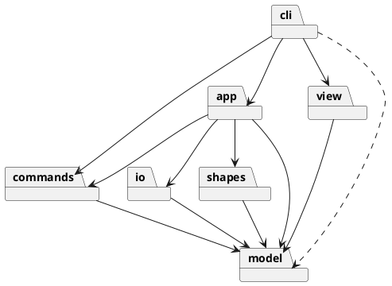

# 设计文档

> 依据 [phase_cli_1.md](file:///d:/VScode-workspace/typescirpt-projects/SVG-Editor-CLI/docs/phase_cli_1.md) 细化。本文只记录**设计决策与实现骨架**，命令语法、错误文案以需求文档为准，不在此重复。

## 0. 关键决策

| # | 决策 | 理由 |
|---|------|------|
| 1 | 所有图形用 **id 寻址**，`Document` 维护 `id → Shape` 索引与父指针 | 三种通道（CLI/agent/鼠标）共用的唯一寻址方式 |
| 2 | 编辑命令用 **Command 模式 + 快照式 undo**；一条命令一个 undo 单元 | 撤销实现简单、可精确还原浮点值；`group` 等复合操作天然原子 |
| 3 | **io 边界截断历史**：`init/read/save/canvas 改尺寸` 后清空栈并锁定，下一条编辑命令解禁 | 满足"io 后 undo/redo 禁止"；避免撤销跨越存档点 |
| 4 | 容器与叶子统一接口（Composite）；**组不保存 `transform`**，读入时把 `translate/scale` **扁平化**到子元素几何值 | 让 `move/scale/undo/序列化` 只有一套语义；`rotate/matrix` 本期不支持 |
| 5 | 类型按名分派只通过 `ShapeRegistry`（插件插槽），命令名分派只通过 `CommandDispatcher` | 需求允许的两处分派点，标注为待重构 |
| 6 | XML 解析用 `fast-xml-parser`；序列化由 `io` 手写生成器，图形只产出**标签/属性数据** | 不在每个图形类里重复缩进、转义逻辑；model 不碰文件与 XML 文本 |
| 7 | 外部 SVG 中**缺 id 自动补+警告**；不支持的标签跳过+警告；重复 id 重命名+警告 | 读入容错，且不静默吞数据 |
| 8 | 测试用 `vitest`，依赖规则用 `dependency-cruiser` | 支持 TS 直跑；依赖方向可量化检查 |

---

## 1. 目录结构

```text
src/
├── index.ts                 # 组合根：装配 FileStore / Editor / Dispatcher / Repl
├── model/                   # 领域核心，零外部依赖（不 import 其它模块）
│   ├── Shape.ts             # 抽象基类
│   ├── Group.ts             # Composite 容器
│   ├── Document.ts          # 画布 + 根节点 + id 索引
│   ├── ShapeProvider.ts     # 图形类型插槽接口（kind / params / create）
│   ├── ShapeRegistry.ts     # kind → provider
│   ├── ShapeSnapshot.ts     # 撤销快照类型
│   ├── SvgNodeData.ts       # 序列化中间数据（tag / attrs / text / children）
│   ├── NumberFormat.ts      # 数字解析与稳定格式化
│   └── DomainError.ts       # 业务错误（message 即 error: 后的文本）
├── shapes/                  # 只依赖 model
│   ├── Rect.ts  Circle.ts  Ellipse.ts  Line.ts  Text.ts
│   └── BuiltinShapes.ts     # 注册 rect/circle/ellipse/line/text/g 六个 provider
├── commands/                # 只依赖 model
│   ├── Command.ts           # 接口 + 执行结果
│   ├── CreateCommand.ts  DeleteCommand.ts
│   ├── MoveCommand.ts  ScaleCommand.ts  SetCommand.ts
│   ├── GroupCommand.ts  UngroupCommand.ts  AddToCommand.ts
│   ├── ZOrderCommand.ts
│   └── CommandHistory.ts
├── io/                      # 只依赖 model
│   ├── SvgSerializer.ts
│   ├── SvgParser.ts
│   ├── FileStore.ts         # 接口
│   └── NodeFileStore.ts     # fs 实现
├── view/                    # 只依赖 model
│   ├── TreeRenderer.ts
│   └── ShapeDetailRenderer.ts
├── app/                     # 门面，装配命令/io/view 的使用者
│   └── Editor.ts
└── cli/                     # 最外层
    ├── Repl.ts
    ├── Tokenizer.ts         # 带 quoted 标记的 token 列表
    ├── CommandDispatcher.ts
    ├── CommandHandler.ts    # 接口：匹配语法、构造 Command、调 Editor
    └── handlers/            # 每个命令一个 handler 类（InitHandler.ts … HelpHandler.ts）
test/
├── model/  commands/  io/  view/  cli/
docs/README.md               # 最终提交的架构文档（需求写作 doc/README.md，本仓库沿用 docs/）
```

约定：**一类一文件、文件名 = 类名**；模块间用相对导入；除 `index.ts` 与 `Repl` 外不写控制台。

---

## 2. 模块职责

| 模块 | 职责 | 关键类 |
|------|------|--------|
| **model** | 图形/文档抽象、Composite 语义、id 索引、类型插槽；不感知文件、命令、控制台 | `Shape`, `Group`, `Document`, `ShapeProvider`, `ShapeRegistry`, `DomainError` |
| **shapes** | 叶子图形的几何、`set` 白名单、缩放规则、显示字段、SVG 属性数据；内置注册 | `Rect`, `Circle`, `Ellipse`, `Line`, `Text`, `BuiltinShapes` |
| **commands** | 把每个编辑操作封装成可撤销对象，只操作 `Document`；历史栈规则 | 各 `*Command`, `CommandHistory` |
| **io** | 文本/文件 ↔ `Document`；解析容错、变换扁平化、序列化格式 | `SvgParser`, `SvgSerializer`, `FileStore`, `NodeFileStore` |
| **view** | `tree` / `show` 的文本布局（缩进、连接符、对齐），字段内容来自图形自身 | `TreeRenderer`, `ShapeDetailRenderer` |
| **app** | 当前文档 + 历史 + 文档类命令编排 + provider 查询；唯一的业务门面 | `Editor` |
| **cli** | 分词、命令名 → handler、参数校验、`error:` 输出、REPL 生命周期 | `Repl`, `Tokenizer`, `CommandDispatcher`, 各 handler |

`commands/` 是**可撤销操作对象**；`cli/handlers/` 是**输入翻译层**，两者不混用命名。

---

## 3. 核心模型

### 3.1 `Shape` 抽象基类

```ts
abstract class Shape {
  readonly id: string;
  parent: Group | null;
  abstract readonly kind: string;              // 'rect' | 'circle' | ... | 'g'

  abstract move(dx: number, dy: number): void;
  abstract scale(factor: number): void;
  abstract getAttr(attr: string): string | undefined;
  abstract setAttr(attr: string, value: string): void;  // 白名单校验，非法抛 DomainError

  abstract snapshot(): ShapeSnapshot;          // 撤销用
  abstract restore(state: ShapeSnapshot): void;

  abstract treeFields(): string;               // tree 行内字段（不含 id）
  abstract detailFields(): string[];           // show 的明细行（不含首行与缩进）
  abstract toSvgNode(): SvgNodeData;           // 序列化数据，不生成字符串
}
```

- 属性白名单、几何字段名、缩放规则都放在**子类**里，内核不出现 `switch(tag)`。
- 叶子图形的公共属性：`fill` / `stroke` / `stroke-width`；各自几何属性见需求 4.1；`Text` 额外支持 `text`。
- 缺省属性不写入 SVG、不在 tree/show 中显示（沿用 SVG 渲染默认）。

### 3.2 `Group`（Composite）

- 持有 `children: Shape[]`，提供 `append / insertAt / removeAt / indexOf / childrenOf`。
- `move` 递归到每个子孙；`scale` 递归；`setAttr` 只接受公共样式属性（写在 `<g>` 上，不下发）；`snapshot/restore` 递归。
- `treeFields()` 返回空串；`toSvgNode()` 递归生成 children。
- 组**不保存 transform**，因此没有"组自身坐标"这一概念。

### 3.3 `Document`

```ts
class Document {
  width: number; height: number;
  readonly root: Group;              // 不可被命令寻址（id 为 `svg` 仅用于显示）
  filePath: string | null;           // read/save 记住，供无参 save
  private index: Map<string, Shape>; // id → shape，含所有子孙

  find(id: string): Shape;           // 无则抛 `no such shape: x`
  has(id: string): boolean;
  attach(shape: Shape, parent: Group, index?: number): void;
  detach(shape: Shape): { parent: Group; index: number };
  reparent(shape: Shape, parent: Group, index?: number): void;
  elementCount(): number;            // 不含根 svg
}
```

- **一致性**：`attach/detach/reparent` 是修改树的唯一入口，同时维护父指针与索引；命令不得直接 `children.push`。
- 所有命令先**校验完再修改**，失败不改变任何状态（需求"命令失败不改变任何状态"）。
- id 大小写敏感；`attach` 遇重复 id 抛 `id already exists: x`。

### 3.4 类型插槽

```ts
interface ParamSpec {
  name: string;                 // x / width / fill / text ...
  type: 'number' | 'text';
  optional: boolean;
}

interface ShapeProvider {
  readonly kind: string;
  readonly container: boolean;
  readonly params: readonly ParamSpec[];
  create(id: string, args: Record<string, string>): Shape; // args 键为属性名，文本内容键 `text`
}

class ShapeRegistry {
  register(provider: ShapeProvider): void;
  get(kind: string): ShapeProvider;   // 无则抛 `unknown shape type: x (is the plugin loaded?)`
  kinds(): string[];
}
```

- `BuiltinShapes.register(registry)` 注册六个 provider；`g` 的 provider 只 `new Group(id)`。
- `create` 命令的参数校验（数量、数字类型）由 handler 读取 `provider.params` 完成；`create` 具体构造由 provider 负责。
- `io` 解析时**不走命令参数校验**：provider 对缺失/非法属性取 0 或空串默认值。
- 后续 `box` 插件就是新增一个 provider（+ `data-kind` 还原），内核无需改动。

### 3.5 错误模型

- 所有业务错误抛 `DomainError(message)`，`message` 就是输出中 `error: ` 之后的部分，例如 `new DomainError('no such shape: r9')`。
- `Repl` 统一捕获：`DomainError` → `error: ${message}`；非预期异常 → `error: internal error: ${message}`（不打印堆栈）。
- `read` 的警告是**普通输出行**（`warning: ...`），不阻断读取。

### 3.6 数字与格式

- 内部一律 `number`；CLI 参数用严格数字解析，非法抛 `invalid number: <s>`。
- 输出/序列化统一走 `NumberFormat.format(n)`：最多 6 位小数、去掉尾随 0、`-0` 归一为 `0`（如 `130`、`0.1`）。
- 读入外部 SVG 时用宽松解析（允许 `10px` 这类带单位值，取数值部分）。

---

## 4. Command 模式

### 4.1 接口与历史

```ts
interface CommandResult { lines: string[] }   // 成功反馈（不含 error: 前缀）

interface Command {
  execute(doc: Document): CommandResult;
  undo(doc: Document): CommandResult;
}

class CommandHistory {
  execute(cmd: Command): void;   // 成功后入栈、清空 redo、解除 io 锁
  undo(): string[];              // 空栈 → nothing to undo；锁 → undo not allowed after io command
  redo(): string[];              // 空栈 → nothing to redo；锁 → 同上固定文案
  truncateAndLock(): void;       // io 命令调用：清空双栈并锁定
}
```

- 一条编辑命令 = 一个 undo 单元；`group` 整体入栈一次。
- `redo` 就是重新执行同一 `Command.execute`，回显与首次一致。
- 锁定期间拒绝 undo/redo；任何**成功的**编辑命令都会解锁（但历史已从存档点重新开始）。

### 4.2 各命令的撤销状态

| 命令 | 执行 | undo 所需状态 |
|------|------|---------------|
| `CreateCommand` | 校验 id/容器 → `provider.create` → `attach` | 被创建子树的 id 列表（`detach` 并移出索引） |
| `DeleteCommand` | 记录父与索引 → `detach` 整棵子树 | 子树对象、原父、原索引 |
| `MoveCommand` | 递归 `move(dx,dy)` | `dx,dy`（undo 取反） |
| `ScaleCommand` | 递归 `scale(f)` | **整棵子树属性快照**，原位 `restore`（避免 `1/f` 浮点漂移） |
| `SetCommand` | 校验白名单 → `setAttr` | `id, attr, oldValue` |
| `GroupCommand` | 校验 → 逐成员记录原父/索引并摘下 → 新建 `Group` 插入锚点 → 收入成员 | 每个成员的原父/索引；新组 id |
| `UngroupCommand` | 记录 g 的父/索引与子顺序 → 子提升到 g 的位置 → 删除 g | g 对象、原父/索引、子顺序 |
| `AddToCommand` | 记录原父/索引 → 追加到目标容器末尾 | 原父/索引 |
| `ZOrderCommand` | 同父内移到最前/最后 | 原索引 |

`group` 的锚点规则（需求未规定，作为决策）：新容器插入**第一个成员的原父容器**，位置为所有成员摘除后第一个成员的索引；跨父容器收编允许。校验包括：成员 id 都存在、互不重复、没有"某成员是另一成员祖先"的关系（否则 `cannot group a container into its own descendant: x`）。

### 4.3 命令反馈文案

| 命令 | 成功回显 | undo 回显 |
|------|----------|-----------|
| init | `canvas 800x600 created` | —（清栈） |
| read | 警告行 + `read <path> (<n> elements)` | — |
| save | `saved to <path> (<n> elements)` | — |
| canvas | `canvas 800x600` / `canvas resized to 1000x500` | — |
| create | `rect#bg created` / `rect#start created in g#node1` | `rect#bg creation undone` |
| delete | `rect#box deleted` | `rect#box restored into g#markers`（根为 `svg`） |
| move | 叶子：`circle#c1 moved to (130,100)`；容器：`g#node2 moved by (0,100)` | 叶子：`moved back to (100,100)`；容器：`moved back by (0,-100)` |
| scale | `rect#r1 scaled by 2` | `rect#r1 scaled back by 0.5` |
| set | `text#title updated: text="My Diagram v2"` | `text#title updated: text="My Diagram"` |
| group | `g#markers created with 2 children` | `g#markers grouping undone` |
| ungroup | `g#markers ungrouped (2 children)` | `g#markers regrouped (2 children)` |
| addto | `rect#r1 moved into g#g1` | `rect#r1 moved back into svg` |
| front/back | `rect#r1 moved to front` / `to back` | `rect#r1 z-order restored` |
| undo/redo 空栈 | `error: nothing to undo` / `error: nothing to redo` | — |

`move` 的"位置"取锚点：rect/text `(x,y)`，circle/ellipse `(cx,cy)`，line `(x1,y1)`。

### 4.4 需求未覆盖的错误（补充约定）

以下错误由设计补充，格式仍遵循 `error: <message>`：

| 场景 | 输出 |
|------|------|
| 参数数量/语法不对 | `error: usage: <该命令语法>` |
| 数字非法 | `error: invalid number: <token>` |
| 未知命令 | `error: unknown command: <name>` |
| 无参数 save 且从未 read/save | `error: no file path (use 'save <file>')` |
| 把图形移进自己 | `error: cannot addto a shape into itself: <id>` |
| addto/group 造成环 | `error: cannot addto a container into its own descendant: <id>` |
| XML 结构非法 | `error: invalid SVG: <detail>` |

---

## 5. IO 设计

### 5.1 解析（`SvgParser.parse(text) → { doc, warnings }`）

1. `fast-xml-parser` 关掉属性前缀、保留文本；根元素必须是 `<svg>`，否则 `invalid SVG`。
2. 画布尺寸：`width/height` → 缺省取 `viewBox` 的第 3/4 个数 → 再缺省 `800x600`。
3. 递归遍历子元素：
   - 命中 `registry` 的类型 → 用元素属性（+ 文本内容）调 `provider.create` 建节点，挂到当前容器；
   - 未注册标签（`path/defs/use/...`）→ **跳过整棵子树**，输出 `warning: unsupported element <path> skipped`；
   - `title/desc/comment` 静默忽略。
4. **id 处理**：
   - 缺失 id → 按 `标签名+序号` 分配（`rect1`, `rect2`…），跳过已被占用的名字，并输出 `warning: assigned id rect1 to unnamed <rect>`；
   - 重复 id → 保留第一个，后续重命名为 `原名_2`（递增），输出 `warning: duplicate id r1 renamed to r1_2`。
5. **transform 扁平化**：每层 `<g>` 的 `transform` 只解析 `translate(...)` / `scale(...)`，按 SVG 语义左乘组合成仿射矩阵，作用到子孙的几何属性；叶子元素自身的 `transform` 同样作用到自己的几何值。`rotate/matrix/skew` → 输出 `warning: unsupported transform "<原文>" ignored`，该层按单位阵处理。组本身不保留 transform。
6. 属性默认值：缺失几何属性按 0；`fill/stroke` 原样保存字符串；未知属性丢弃（本期不做保真 round-trip）。

### 5.2 序列化（`SvgSerializer.serialize(doc) → string`）

- 由 `Shape.toSvgNode()` 产出数据，序列化器负责缩进（2 空格）、自闭合、XML 转义、属性顺序。
- 头部固定：

```xml
<?xml version="1.0" encoding="UTF-8"?>
<svg xmlns="http://www.w3.org/2000/svg" width="800" height="600" viewBox="0 0 800 600">
```

- 属性顺序：`id` → 几何属性 → `fill/stroke/stroke-width`；空元素用 `<rect ... />`。
- 本期不写 `data-kind`（留给插件阶段）。

### 5.3 文件访问

```ts
interface FileStore {
  readText(path: string): string;
  writeText(path: string, text: string): void;
}
```

`NodeFileStore` 包装 `fs`，异常统一转 `cannot read file: <path>` / `cannot write file: <path>`。测试用内存实现或临时目录，`io` 不直接依赖 `fs`。

---

## 6. 显示格式

### 6.1 tree（`TreeRenderer`）

- 根行：`svg (800x600)`。
- 每行：`<连接符><kind>#<id>` + 两空格 + `treeFields()`；无字段的容器不补齐空格。
- 同一份输出内按最宽标签对齐字段；连接符 `├── / └──`，子层前缀 `│   /     `。
- `tree <id>`：以该节点为根重画（叶子根行不再带 `svg` 前缀）。

### 6.2 show（`ShapeDetailRenderer`）

```text
circle#c1  parent=g#markers
  cx=100 cy=100 r=20
  fill=red
```

- 首行父级标签：根为 `svg`，否则 `kind#id`；
- 几何字段一行，样式属性各占一行，text 追加 `text="..."`，容器追加 `children=<n>`；
- 缺省属性不输出。

---

## 7. App 与 CLI

### 7.1 `Editor`（app 门面）

```ts
class Editor {
  init(width: number, height: number): string[];
  read(path: string): string[];
  save(path?: string): string[];
  canvas(width?: number, height?: number): string[];
  providerFor(kind: string): ShapeProvider;
  execute(cmd: Command): string[];
  undo(): string[];
  redo(): string[];
  requireDocument(): Document;   // 无文档抛 no document. use 'init' or 'read' first
}
```

- 构造时注入 `FileStore`、`SvgParser`、`SvgSerializer`、`CommandHistory`，并注册 `BuiltinShapes`。
- `init/read` 换文档并 `truncateAndLock()`；`save`、`canvas` 改尺寸同样 `truncateAndLock()`；`canvas` 只读不锁。
- `execute` 只接受编辑命令，负责调用 `history.execute`。

### 7.2 CLI

- `Tokenizer`：按空白分词，双引号内保留空格；Token 带 `quoted` 标记（`create text t1 20 40 "in"` 中的 `"in"` 不是 `in` 子句）。
- 注释：整行 `trimStart()` 后以 `#` 开头才忽略；空行忽略。
- `CommandDispatcher`：`Map<string, CommandHandler>`，构造时注册 15 个 handler；找不到 → `unknown command`。
- `CommandHandler`：`matches(name)` + `run(tokens, editor): string[]`；负责语法校验、`in` 子句识别、把参数翻译成 Command/文档调用。
- `Repl`：注入 `readline` 与输出函数（便于测试），行为：
  1. 启动打印 `svg-editor 0.1 — type 'help' for commands`；
  2. 提示符 `svg> `；
  3. 逐行分词 → 分发 → 逐行输出；
  4. `DomainError` → `error:` 行；
  5. EOF / Ctrl+C 结束（不提供额外退出命令）。
- `index.ts` 是唯一组合根：`NodeFileStore` + `Editor` + `Dispatcher` + `Repl`，`npm run cli` 指向它。

---

## 8. 依赖方向规则

**允许的依赖（行依赖列）：**

| ↓ 依赖 →     | model | shapes | commands | io   | view | app  | cli  |
| ------------ | ----- | ------ | -------- | ---- | ---- | ---- | ---- |
| **model**    | —     | ✗      | ✗        | ✗    | ✗    | ✗    | ✗    |
| **shapes**   | ✓     | —      | ✗        | ✗    | ✗    | ✗    | ✗    |
| **commands** | ✓     | ✗      | —        | ✗    | ✗    | ✗    | ✗    |
| **io**       | ✓     | ✗      | ✗        | —    | ✗    | ✗    | ✗    |
| **view**     | ✓     | ✗      | ✗        | ✗    | —    | ✗    | ✗    |
| **app**      | ✓     | ✓      | ✓        | ✓    | ✗    | —    | ✗    |
| **cli**      | ✓*    | ✗      | ✓        | ✗    | ✓    | ✓    | —    |

`*` cli 只用 model 的类型做参数标注，不直接操作其内部。`index.ts` 作为组合根不受此表约束。



**理由：**

1. **model 零依赖**：最稳定的核心，不知道文件、命令、控制台，可脱离 CLI 单测；未来换 GUI/agent 不动它。
2. **shapes 只依赖 model**：具体图形是 `Shape` 的实现；内核只通过 `ShapeRegistry` 消费，为插件化留口。
3. **commands 不依赖 io/cli/app**：命令只操作模型，可被任意通道复用。
4. **io 与 commands 互不依赖**：存取与编辑是两个正交变化轴。
5. **view 只读模型**：换显示格式只改这一层。
6. **app 是唯一装配点**：注册 provider、编排 io 与 history。
7. **cli 在最外层**：没有任何模块依赖 cli。

用 `dependency-cruiser` 把上表写成 `forbidden` 规则，纳入 `npm test`，作为"一致性自查"的量化证据。

---

## 9. 设计模式落地

| 模式 | 落地点 | 说明 |
|------|--------|------|
| **Command**（必需） | `commands/*Command` + `CommandHistory` | 一条编辑命令一个对象，`execute/undo` 撤销单元；CLI 只负责构造 |
| **Composite** | `Shape` ↔ `Group` | `move/scale/set/delete/序列化/tree` 对容器与叶子一视同仁 |
| **Factory / Plugin** | `ShapeProvider` + `ShapeRegistry` | 类型按名分派唯一入口，后续 `box` 零内核改动 |
| **Facade** | `Editor` | 对 CLI 隐藏文档、历史、IO 的协作细节 |
| **Strategy / DI** | `FileStore`、注入的 parser/serializer | 测试可替换内存存储，不碰真实文件 |

**按名分派仅两处**（均标注待重构）：`CommandDispatcher`（命令名 → handler）、`ShapeRegistry`（类型名 → provider）。其余地方禁止 `switch(kind/tag)`。

---

## 10. 变化点与预留

| 变化点 | 现在怎么做 | 留了什么 / 为什么不留 |
|--------|-----------|----------------------|
| 新增图形类型（`box`） | `ShapeProvider` + `ParamSpec` | 留了注册插槽、复合图形还原标记位；本期不实现插件加载器，`create box` 报未知类型 |
| 新增命令 | 一条命令一个 Command + handler | 命令对象与分发表独立；不预留宏/脚本 DSL |
| 撤销粒度变化（事务） | 一命令一单元 | Command 接口可组合；不做事务容器 |
| 持久化后端（JSON/DB/云） | `FileStore` + 独立序列化器 | 换存储只实现接口；不预留异步 API（当前同步足够） |
| 交互通道（GUI/agent） | `Editor` + headless Command | 模型/命令不依赖 console；不预留事件总线 |
| 显示格式（JSON/富文本） | `view` 两个 renderer | 图形只提供字段，布局集中；不做主题配置 |
| `transform` / 坐标系 | 读入扁平化，组不存 transform | **不留**：本期命令语义（容器平移/缩放递归）与 transform 并存会引入两套坐标，权衡后放弃；`rotate/matrix` 明确不支持 |
| 样式能力（CSS/渐变） | 属性按字符串透传 | 不预留样式引擎；`set` 白名单外一律拒绝 |

---

## 11. 测试与质量保证

- 新增依赖：运行时 `fast-xml-parser`；开发期 `vitest`、`dependency-cruiser`。
- `package.json` 增加脚本：`cli`（`ts-node src/index.ts`）、`test`（`vitest run`）、`deps:check`、`build`。
- 测试分层：
  1. **model/shapes**：`move/scale/set` 数值、白名单、快照往返、序列化属性；
  2. **commands**：每个命令的 execute→undo→redo 状态一致；失败不改状态；io 锁；
  3. **io**：解析需求示例、缺 id 补全、重复 id、未支持标签、translate/scale 扁平化、parse→serialize→parse 往返；
  4. **cli**：把需求第 6 节的 transcript 作为 **golden 用例**，注入内存输入/输出逐行比对；
  5. **依赖规则**：`dependency-cruiser` 校验第 8 节表格。
- 手工验收：`npm run cli` 跑通第 6 节与 6.1 节两条会话，`save` 产物用浏览器/VSCode SVG Preview 打开确认。

---

## 12. 开发顺序（对应分步提交）

1. 工程骨架：脚本、`model` 接口与错误、`Document` 索引（+ 单测）。
2. 内置图形与注册表（`shapes`）。
3. `io` 解析/序列化与文件存储，跑通 round-trip。
4. `commands` 全部编辑操作与 `CommandHistory`。
5. `view` 两个 renderer + `app/Editor`。
6. `cli`：Tokenizer、Dispatcher、handlers、Repl、`index.ts`。
7. 集成 transcript 测试、依赖规则、`docs/README.md`（架构方案/过程记录/自查/质量保证）与 `final` tag。
