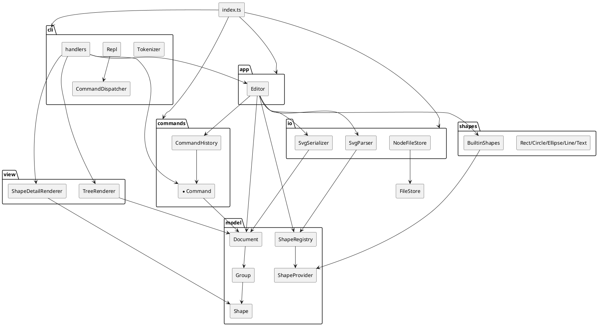

# SVG 编辑器（CLI）— 架构文档

> EIE50009 Lab1 Phase 1。命令语法、错误文案以 [phase_cli_1.md](phase_cli_1.md) 为准；本文记录模块划分、设计模式、依赖规则与变化点假设。
> 需求文档写作 `doc/README.md`，本仓库统一使用 `docs/`（见[修订记录](#修订记录)）。

## 0. 如何运行

```bash
npm install
npm run cli      # ts-node 启动 REPL，提示符 svg>
npm run build    # tsc 类型检查（strict）
npm test         # 137 个 vitest 用例 + 依赖方向检查
```

---

## 1. 架构方案

### 1.1 模块划分与职责

```text
src/
├── index.ts       组合根：装配 FileStore / Editor / Dispatcher / Repl
├── model/         领域核心：图形抽象、Composite、文档树与 id 索引
├── shapes/        内置图形：几何、属性白名单、缩放规则、SVG 属性数据
├── commands/      可撤销编辑操作（Command 模式）
├── io/            SVG 文本 ↔ Document、文件读写边界
├── view/          tree / show 的文本布局
├── app/           业务门面 Editor：当前文档 + 历史 + 文档类命令编排
└── cli/           分词、命令分派、参数校验、REPL 生命周期
```

| 模块 | 职责 | 关键类 |
|------|------|--------|
| **model** | 图形/文档抽象、Composite 语义、id 索引、类型插槽；不感知文件、命令、控制台 | `Shape`, `Group`, `Document`, `ShapeProvider`, `ShapeRegistry`, `DomainError`, `NumberFormat`, `Transform2D` |
| **shapes** | 叶子图形的几何、`set` 白名单、缩放规则、显示字段、SVG 属性数据；内置注册 | `Rect`, `Circle`, `Ellipse`, `Line`, `Text`, `BuiltinShapes` |
| **commands** | 把每个编辑操作封装成可撤销对象，只操作 `Document`；历史栈与 io 锁 | `CreateCommand`, `DeleteCommand`, `MoveCommand`, `ScaleCommand`, `SetCommand`, `GroupCommand`, `UngroupCommand`, `AddToCommand`, `ZOrderCommand`, `CommandHistory` |
| **io** | 文本/文件 ↔ `Document`；解析容错、变换扁平化、序列化格式 | `SvgParser`, `SvgSerializer`, `FileStore`, `NodeFileStore` |
| **view** | `tree` / `show` 的缩进、连接符、字段对齐 | `TreeRenderer`, `ShapeDetailRenderer` |
| **app** | 当前文档 + 历史 + 文档类命令编排 + provider 查询 | `Editor` |
| **cli** | 分词、命令名 → handler、参数校验、`error:` 输出、REPL | `Tokenizer`, `CommandDispatcher`, `CommandHandler`, `Repl`, 19 个 handler |

### 1.2 组件图



### 1.3 设计模式

**Command 模式（必需）**

- [Command.ts](src/commands/Command.ts) 定义 `execute(doc) / undo(doc)`；每个编辑命令是一个类，一条命令 = 一个 undo 单元。
- 撤销所需状态在 **execute 时捕获到命令对象内部**（原父/原索引、位移增量、子树快照），`undo` 只做反向操作，`redo` 就是重新 `execute`，因此 redo 回显与首次天然一致。
- [CommandHistory.ts](src/commands/CommandHistory.ts) 负责双栈、清空 redo、io 锁（`truncateAndLock`）。命令不关心历史，历史不关心命令语义。
- 选择快照式而非 `1/factor` 反算：`scale`/`set` 的 undo 用 `snapshot()/restore()` 原位还原，避免浮点误差累积，也能把"属性从未设置"还原为缺省状态。

**Composite**

- `Shape` 抽象出 `move / scale / setAttr / snapshot / restore / treeFields / detailFields / toSvgNode`；`Group` 递归实现，叶子各自实现。命令与渲染器对容器和叶子一视同仁，没有 `switch(tag)`。

**工厂 / 插槽（两处按名分派之一）**

- `ShapeProvider` 声明 `kind / container / params / create`；`ShapeRegistry` 保存 `kind → provider`。`BuiltinShapes` 注册六个内置类型，`box` 插件只需新增一个 provider，内核无需改动。
- `create` 命令的语法校验由 CLI 按 `provider.params` 完成，构造由 provider 负责，io 解析也走同一个注册表（不认识具体图形类）。

**策略 / 边界接口**

- `FileStore` 抽象文件读写，`NodeFileStore` 是 fs 实现，测试用内存实现替换。
- 两个 renderer 只消费 `treeFields()/detailFields()`，文本布局变化不出 view 模块。

**分派（两处按名分派）**

- 命令名 → handler：`CommandDispatcher` 内部一个 `Map`，集中在 [CommandDispatcher.ts](src/cli/CommandDispatcher.ts)。
- 图形类型 → 类：`ShapeRegistry`。

两处都是需求允许的分派点，已在代码注释中标注**待重构**（后续可替换为插件注册表 / 配置驱动）。

### 1.4 依赖方向规则

允许的依赖（箭头表示"可以依赖"）：

| 模块 | 可以依赖 | 理由 |
|------|----------|------|
| `model` | 无（仅 TS 标准类型） | 领域核心必须可独立演进，不能被 io/UI 反向绑住 |
| `shapes` | `model` | 图形是模型的扩展，只实现抽象接口 |
| `commands` | `model` | 编辑操作只操作文档树 |
| `io` | `model` | 解析/序列化产出/消费模型，不认识具体图形类（经注册表） |
| `view` | `model` | 渲染只看图形提供的字段 |
| `app` | `model`, `commands`, `io`, `shapes` | 门面负责编排，是唯一允许同时看到这些模块的层 |
| `cli` | `app`, `commands`, `view`, `model` | 输入翻译层；不认识 io 与具体图形实现 |
| `index.ts` | 全部 | 组合根，唯一装配具体实现的位置 |

规则落地：[.dependency-cruiser.cjs](.dependency-cruiser.cjs) 用 `forbidden` 规则表达同一张表，`npm test` 最后一步执行 `depcruise src`；违反即构建失败。`index.ts` 作为组合根在所有规则中豁免。

### 1.5 变化点假设

| # | 未来最可能的变化 | 留了什么 | 说明 |
|---|------------------|----------|------|
| 1 | 新增图形类型（如 `box` 复合图形） | `ShapeProvider` 插槽 + 注册表 | 只需新增 provider 文件并注册；解析端按 `data-kind` 还原，内核不改 |
| 2 | 新增/修改命令语法 | handler + Command 类各一处 | 分派表集中，业务规则不散落在 REPL |
| 3 | 输出格式调整（tree/show/SVG） | view 渲染器、SvgSerializer 各自独立 | 图形只提供字段/属性数据，不生成字符串 |
| 4 | 存储介质变化（内存、远程、浏览器） | `FileStore` 接口 | 替换实现即可，Editor 不变 |
| 5 | 需要支持 `rotate`/`matrix` | `Transform2D` 四参数退化为 2×3 矩阵 | 本期明确不支持：解析到这些函数时给警告并按单位阵处理，避免"静默错误"；升级路径是把 `Transform2D` 换成完整仿射矩阵并改 `applyTransform` |
| 6 | undo 策略改为增量 diff | Command 封装 | 调用方只看到 `execute/undo`，历史栈无需感知 |
| 7 | 外部 SVG 出现更多未知标签/方言 | 解析警告集中在一处 | 当前策略：跳过并警告，不静默吞数据 |
| 8 | 多用户/并发编辑 | **决定不留** | 本阶段是单进程单文档 CLI，引入锁与版本号没有真实收益 |
| 9 | 语言本地化（中文错误文案） | **决定不留** | 需求规定英文固定文案，集中常量即可后续替换，提前抽 i18n 层是过度设计 |

---

## 2. 过程记录

按开发顺序分步推进，每步一个 commit；下为有代表性的讨论与纠错。

**Step 1（骨架）**

- 设计文档初稿把 `NumberFormat` 的数字解析失败抛成了普通 `Error`，REPL 会把它归为 `internal error`。对照需求"错误统一 `error:` 前缀"后改为 `DomainError`，让文案直接可用。
- `tsconfig` 开启 `noUncheckedIndexedAccess` 与 `exactOptionalPropertyTypes`；据此在 `Document` 的索引访问、可选参数处补了显式判空，避免"编译过、运行时 undefined"。

**Step 2（图形）**

- `Document.reparent` 最初把"同父同索引"也走一遍 detach/attach，会短暂丢索引；改为检测到同父且索引未变时提前返回。
- 生成 `move/scale` 代码时发现每个叶子各写一遍几何变换，后续 transform 扁平化会重复；抽出 `Transform2D` + `applyTransform`，`move = {1,1,dx,dy}`、`scale = {f,f,0,0}`，为 Step 3 的解析复用。
- Git 在 Windows 下提示 CRLF 将被转换，补 `.gitattributes` 固定 LF，避免测试里 round-trip 字节比较受换行影响。

**Step 3（io）**

- 设计文档 5.2 把空元素写成 `<rect ... />`（斜杠前有空格），但需求 0.1 的两个示例均为 `<rect .../>`。以需求示例为准，并把这条偏差记入修订记录。
- 解析器最初想按标签名直接 `new Rect(...)`，这会让 io 依赖 shapes 并复制参数表；改为只经 `ShapeRegistry` + `provider.create`，io 保持只依赖 model。
- 嵌套 `transform` 的扁平化用组合矩阵实现：`translate(60,40)` 外层 + `translate(200,0) scale(0.8)` 内层，测试断言内层 rect 落在 `x=260 y=40 w=96 h=48`，与需求 0.1 的视觉一致。
- `rotate/matrix` 不在本期范围：选择"警告 + 按单位阵"而不是忽略整段属性，保证用户能看到降级行为。

**Step 4（命令）**

- `ScaleCommand` 最初打算 undo 时乘 `1/factor`，3 倍缩放再回退会得到 `33.333333...`；改为执行前 `snapshot()`、undo `restore()`，测试用 3 倍缩放验证精确回到 `100`。
- `group` 的锚点没有需求规定：定为"第一个成员的原父容器、摘除后第一个成员的索引"，并处理了"同父且排在前面的成员也被摘走导致索引左移"的情况。
- 编译检查发现 `GroupCommand` 里集合变量名写错（`set.has` → `memberSet.has`），此类错误由 `tsc` 立即暴露。

**Step 5（视图与门面）**

- `show` 首行最初对根级图形输出 `parent=g#svg`，根节点实际 id 是 `svg`、且不进索引；改为通过 `parent.parent === null` 识别根容器，输出 `parent=svg`。
- 需求 5.1 的 tree 示例字段列严格对齐，但 6.1 示例的空格数自相矛盾（同列相差 1~2 格）。放弃逐字复刻 6.1，采用确定性规则"同份输出按最宽标签对齐 + 2 空格"，5.1 示例逐字通过。
- `save` 无参数且从未 read/save 时需求未给文案，补 `no file path: use 'save <file.svg>'` 并记入修订记录。

**Step 6（CLI）**

- `create text t1 20 40 "in"` 与 `... in g1` 存在歧义；在 Tokenizer 增加 `quoted` 标记，只有未加引号的 `in` 才被当作子句。
- 需求未规定参数个数错误文案，统一为 `usage: <语法>`；`init`/`canvas` 只接受 0 或 2 个参数（只给 1 个时报 usage），避免"只改宽不改高"的半更新状态。
- REPL 的输入边界做成 `AsyncIterable`，`readline.Interface` 直接满足，测试注入数组即可回放 transcript，不需要伪终端。

**Step 7（集成与收尾）**

- transcript 测试直接回放需求 §6 的完整会话，逐字比对 34 行输出；顺手验证 `save` 产物的头部与尺寸。
- 依赖检查发现 `Shape ↔ Group` 的 type-only 回路（`Shape.parent` 需要 `Group` 类型）。运行时无环、编译后擦除，故在规则中显式豁免这两个文件并写明理由；其余模块零违规。

---

## 3. 一致性自查

### 3.1 模块划分

实际目录与 [design.md §1](design.md) 一致：`model / shapes / commands / io / view / app / cli` 七个模块，一类一文件。

不一致之处（均已记入修订记录）：

1. 新增 `src/cli/BuiltinHandlers.ts`：集中 19 个 handler 的清单，供组合根和测试复用（设计文件清单中未列）。
2. 增加了测试支撑 `test/support/session.ts`（内存 FileStore + 假终端 + 会话回放）。
3. 依赖规则配置文件 `.dependency-cruiser.cjs` 放在仓库根目录（工具默认位置），不属于 `src` 模块。
4. 文档目录沿用 `docs/`（需求写作 `doc/`）。

### 3.2 依赖方向

`npm run deps:check` 结果：

```text
✔ no dependency violations found (61 modules, 243 dependencies cruised)
```

抽样核对：

- `src/model/*` 只互相导入，无第三方运行时依赖；
- `src/io/SvgParser.ts` 只导入 `model` 的 `ShapeRegistry/Document/NumberFormat/Transform2D`，不导入 `shapes`；
- `src/view/*` 只导入 `model`；
- `src/app/Editor.ts` 导入 `commands/io/shapes/model`，不导入 `view/cli`；
- `src/cli/handlers/CreateHandler.ts` 导入 `app/commands/model`，不导入 `io`；
- 唯一豁免：`src/index.ts`（组合根）与 `Shape/Group` 的 type-only 回路（见 §2 Step 7）。

---

## 4. 质量保证手段

**功能完整性**

- 需求 §6 的完整会话作为集成测试逐字回放（`test/integration/Transcript.test.ts`）。
- 每个命令都有 `execute → undo → redo` 往返用例，断言回显文案、树结构、属性值三者一致。
- 解析器覆盖：缺 id 自动补 + 警告、重复 id 重命名 + 警告、未支持标签跳过 + 警告、`title/desc` 静默、嵌套 transform 扁平化精确坐标、尺寸三种来源（width/height、viewBox、默认 800×600）、`10px` 宽松解析。
- round-trip：`parse → serialize → parse` 结构等价，序列化产物字节级稳定。

**质量手段**

| 手段 | 说明 |
|------|------|
| TypeScript strict | `strict` + `noUncheckedIndexedAccess` + `exactOptionalPropertyTypes`，`npm run build` 零告警 |
| 单元 + 集成测试 | 14 个测试文件、137 个用例，覆盖 model/shapes/commands/io/view/app/cli 与整链 transcript |
| 依赖方向检查 | dependency-cruiser 规则与 §1.4 矩阵一一对应，纳入 `npm test` |
| 边界注入 | `FileStore` / `ReplIo` 以接口注入，测试不碰真实磁盘与终端；仅 `NodeFileStore` 用 `os.tmpdir()` 做真实读写往返 |
| 真机冒烟 | `npm run cli` 管道回放 `init/create/tree/show/move/undo/save/read`，确认组合根装配正确 |
| 错误路径 | 每个错误文案都有用例（id 冲突/不存在、非容器、成环、顶层 ungroup、非正 factor、非法数字、缺参数、未知命令、未知类型、文件不可读） |

---

## 修订记录

| # | 位置 | 变更 | 原因 |
|---|------|------|------|
| 1 | `SvgSerializer` | 空元素写作 `<rect .../>`（斜杠前无空格） | 以需求示例为准，design.md 5.2 的 ` />` 作废 |
| 2 | `CommandHistory` | `execute/undo/redo` 增加 `doc` 参数 | `Command` 接口需要 `Document`，原签名遗漏 |
| 3 | `TreeRenderer` | `tree <id>` 根行无连接符，子层从第 0 列画 `├──`；字段对齐取"最宽标签 + 2 空格" | 需求两处示例间距不一致，采用确定性规则 |
| 4 | `Editor.save` | 无路径且从未 read/save 时报 `no file path: use 'save <file.svg>'` | 需求未定义该场景文案 |
| 5 | `cli` | 参数个数错误统一 `usage: <语法>`；`init/canvas` 只接受 0 或 2 个参数 | 需求未定义；避免半更新 |
| 6 | `cli` | handler 共 19 个（设计写 15）；新增 `BuiltinHandlers.ts` | 命令名实为 19 个，清单需复用 |
| 7 | `docs` | 架构文档放 `docs/README.md` 而非需求写的 `doc/README.md` | 仓库既有文档目录为 `docs/` |
| 8 | 依赖规则 | 豁免 `Shape ↔ Group` 的 type-only 回路 | 运行时无环，编译后擦除 |
